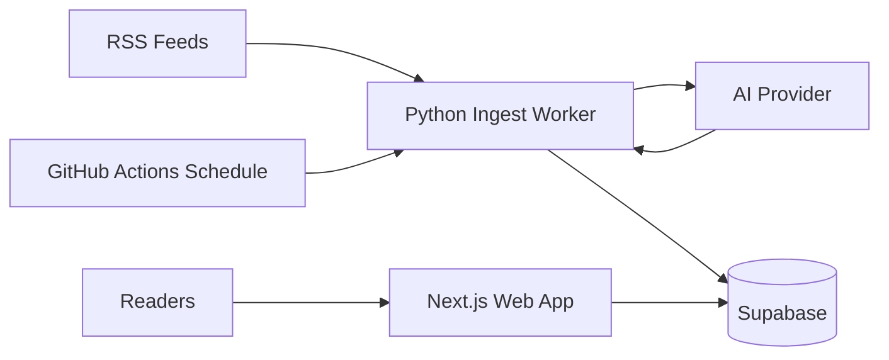

# AI Blogpost Architecture

AI Blogpost is a small polyglot system: a Next.js web app, a Python ingestion worker, and Supabase as the shared persistence layer.

It is not a classic monolith because the read path and write path run as separate runtimes. It is also not a formal package-managed monorepo yet. The repo is structured as a lightweight monorepo-style project with explicit app, service, infrastructure, and documentation boundaries.

## Runtime Boundaries

## Components

- `apps/web`: Next.js app that renders the public site, blog detail pages, tag filtering, and markdown content.
- `services/ingest`: Python worker that fetches RSS feeds, deduplicates candidates, scrapes article context, generates AI posts, validates output, and writes to Supabase.
- `infra/supabase`: Database contract documentation and migration location.
- `.github/workflows`: Scheduled automation for ingestion and RSS health checks.

## Data Flow

1. GitHub Actions starts the ingest worker on a schedule or manual dispatch.
2. The worker fetches RSS feeds and filters for AI + software-engineering items (tiered keyword gate: AI/SWE core terms pass; security/infra/hardware/big-tech/quantum/robotics only pass with an AI or SWE co-signal).
3. Candidate stories are deduplicated and enriched with scraped article content when available.
4. The AI generator returns structured post data.
5. The worker validates and stores the post, tags, sources, and audit metadata in Supabase.
6. The Next.js app reads published posts from Supabase and renders them for readers.

## Architectural Decision

Keep the web app and ingest worker separate. The worker has long-running, network-heavy responsibilities that fit a scheduled batch process better than a request/response web server.

Supabase is the correct integration point at this scale. If the product grows, the next major architecture step should be queue-backed ingestion, not merging the worker into the web app.

## Admin migration in progress (2026-10-30)

The current React/Vite admin and Spring Boot backend remain the deployed system. A separate admin worktree implements the approved TanStack Start replacement: server-owned Supabase Google Auth with HTTP-only cookies, a per-request restricted Postgres connection through cache-disabled Hyperdrive, and Cloudflare Workers Free. Public web and ingest boundaries remain unchanged.

Migration `0005_admin_permissions.sql` is a proposed permission contract, tested only against disposable local PostgreSQL. It adds no columns and has not been applied to production. It limits anon/authenticated reads to public posts/tags/post-tags/approved comments, denies private tables and mutations, preserves service-role worker access, and defines an unprivileged NOLOGIN admin group. A separate login credential is provisioned outside source control after live grants and memberships are inspected.

Real Google flow, direct Supabase Data API checks, staging target mapping, and Workers CPU feasibility remain release gates. This document does not describe the replacement as live.
